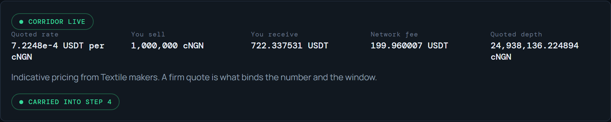
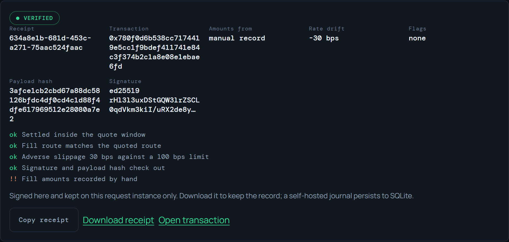
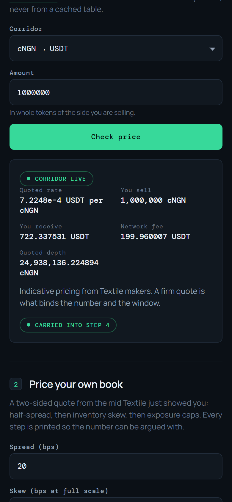

# CorridorProof

CorridorProof turns a Textile FX quote and the fill your agent received into one signed, portable receipt that shows the drift between them. It audits FX agents on Celo, not a swap venue.

Live product: https://corridorproof.vercel.app

## Problem

- An agent trading FX on open rails can be told it received a price. Nothing in the trade proves what was quoted, what was filled, or when the quote stopped binding.
- Quote windows, maker routes and slippage limits are enforced by whoever issued the quote, so the counterparty grades its own work.
- ERC-8021 attribution cannot be added after the fact, so an app that does not tag from its first transaction never can.

## Solution: how it works

CorridorProof reads the quote, records the settlement you observed, and signs the comparison with Ed25519. Each receipt carries its own public key and a SHA-256 payload hash, so verifying it is a public-key operation that needs nothing from this service.

- Rate drift and adverse slippage in basis points, against a limit you set.
- Whether settlement landed inside the quote's expiry window.
- Whether the fill's maker route matches the quoted route.
- The attribution suffix appended to every calldata this service builds, plus a chain-side reader that proves which codes a transaction actually carries.

## See it working

Live product: https://corridorproof.vercel.app

Choose a corridor and the desk reads an indicative price from Textile on Celo mainnet, then carries the quoted legs into the ledger.



Issue a fill and CorridorProof signs a receipt that compares it against the quote: rate drift, adverse slippage against your limit, expiry, route, and how the amounts were sourced.



The same flow runs at phone width.



- Pricing desk: `POST /api/pricing/quote` returns two-sided prices and the decision trace behind each.
- Chain reads: `POST /api/settlement/observe` decodes the transfer logs of a fill; a receipt created with `observe` marks its amounts as chain-sourced.
- Service reads: `GET /api/health` reports chain, attribution code, settlement mode, journal type and journal metrics.
- Attribution: `POST /api/attribution/read` returns the ERC-8021 codes present on a Celo transaction hash.

## Tech stack

| Layer | Technology | Role |
| --- | --- | --- |
| Chain | Celo mainnet, chain 42220 | Settlement and attribution reads via `https://forno.celo.org` |
| Liquidity | Textile FX v2 RFQ API | Indicative and firm quotes, executable swap calldata |
| Attribution | `@celo/attribution-tags` (ERC-8021) | Suffix on built calldata; `verifyTx` reads codes back from chain |
| Identity | ERC-8004 Identity Registry `0x8004A169FB4a3325136EB29fA0ceB6D2e539a432` | Agent registration prepared by `npm run erc8004:prepare` |
| Signing | Node `crypto` Ed25519 | Receipt signatures and offline verification |
| Client | Vite + TypeScript, no UI framework | Corridor desk, ledger, verifier and journal |
| Server | Express locally, Vercel functions in production | Shared handlers in `src/handlers.ts` back both |
| Storage | SQLite locally, append-only JSONL when hosted | Receipt journal |

## Architecture

`src/handlers.ts` holds every route's logic and validation. `src/server.ts` wraps it in Express for self-hosting; twelve `api/*.ts` functions are thin Vercel handlers that call the same actions, so the two deployments cannot drift apart. `src/pricing.ts` computes two-sided desk prices over 1e27 fixed-point rates, `src/pnl.ts` turns fills into realized P&L against a constant-spread baseline, and `src/chain.ts` decodes the ERC-20 transfer logs of a fill. `src/journal.ts` selects SQLite or JSONL by environment, and `better-sqlite3` is an optional dependency so a missing native build cannot break a hosted deploy.

Corridors and token metadata in the client come from the Textile FX address book for chain 42220. A pair that is not enabled there, or has no makers online, is reported as unavailable rather than estimated.

## Settlement safety

Broadcasting moves real value, so it is gated three times over:

- **Mode, never a key.** `executeSwap` takes `"dry-run" | "live"`. A dry run resolves no signing key under any environment, so it cannot broadcast. `settlementKeyFor` has no default parameter, which closes the path where an omitted argument silently picked up `AGENT_PRIVATE_KEY`.
- **Server-issued quotes only.** `POST /api/quote/firm` stores the returned quote against a one-time nonce and hands the nonce to the caller. `POST /api/settle` redeems that nonce and settles the stored calldata, so a request cannot supply its own `to` and `data` and have a funded wallet sign it.
- **Operator arming.** Broadcast needs both `AGENT_PRIVATE_KEY` and `SETTLEMENT_TOKEN`, plus a matching `X-Settlement-Token` header. Without them the endpoint declines and nothing is sent.

Every outbound payload ends with the enrollment suffix, and `assertBroadcastAllowed` refuses to send anything that does not — including a placeholder code, which would produce activity that is not credited to anyone.

## Key features

- Live Textile corridor pricing with network fee and quoted depth, read at request time.
- Two-sided desk pricing with a per-step decision trace, priced against the live mid.
- Quote-versus-fill receipts covering rate drift, adverse slippage, expiry and route.
- Provenance on every receipt — amounts read from chain transfer logs or recorded by hand.
- Ed25519 signatures and the attribution tag reader, both verifiable without this service.
- One handler set behind Express and twelve per-route Vercel functions.

## Quick start

### Prerequisites

Node.js 20+ and npm.

### Setup

```sh
git clone https://github.com/0xdfinity/corridorproof.git
cd corridorproof
npm install
cp .env.example .env
```

### Run

```sh
npm run build
npm start
```

Open http://localhost:3000. The first run writes a signing key to `.data/receipt-ed25519.pem` and a journal to `.data/receipts.sqlite`. Keep both out of source control. Verifying an existing receipt does not depend on the current key, because the public key travels inside the receipt; rotating the key changes only which identity signs what comes next.

### Test

```sh
npm test
```

### Register the agent identity

```sh
npm run erc8004:prepare
```

This writes an unsigned `register(string agentURI)` call for the Celo Identity Registry into `.data/erc8004-registration.json`. Set `AGENT_ADDRESS` and optionally `AGENT_URI` first. It never signs or broadcasts: review the metadata, then execute it from your own funded agent wallet.

### Environment variables

| Variable | Purpose |
| --- | --- |
| `PORT` | Local server port |
| `TEXTILE_API_KEY` | Enables firm RFQ requests; indicative preview works without it |
| `AGENT_PRIVATE_KEY` | Enables settlement. Never commit it; the hosted deployment holds none |
| `SETTLEMENT_TOKEN` | Required header value for `POST /api/settle`; without it broadcast stays off |
| `AGENT_ADDRESS`, `AGENT_URI` | Inputs for the ERC-8004 preparation script |
| `CELO_RPC_URL` | Celo RPC endpoint, defaults to `https://forno.celo.org` |
| `LOOPS_ATTRIBUTION_TAG` | Enrollment code appended to built calldata |
| `RECEIPT_DB` | Journal location |
| `RECEIPT_SIGNING_KEY`, `RECEIPT_PRIVATE_KEY_PEM` | Receipt signing key, on disk or inline |
| `ATTRIBUTION_ALLOW_TX` | Must be `yes` before the service will broadcast attributed activity |

## What this is not

CorridorProof is a taker-side audit layer. It requests quotes, settles them when an operator arms a wallet, and proves what happened. It does not publish prices to the RFQ market, answer solicitations, or hold maker inventory. The pricing desk computes a two-sided book locally so you can audit a decision; it is not wired to a maker feed and places no orders. It reports no maker-side P&L or fill volume because it generates none. The settlement observation you record must itself be trustworthy; a receipt proves a signed record is intact and self-consistent, not that funds moved. This code is unaudited and holds no custody.

## License

MIT
